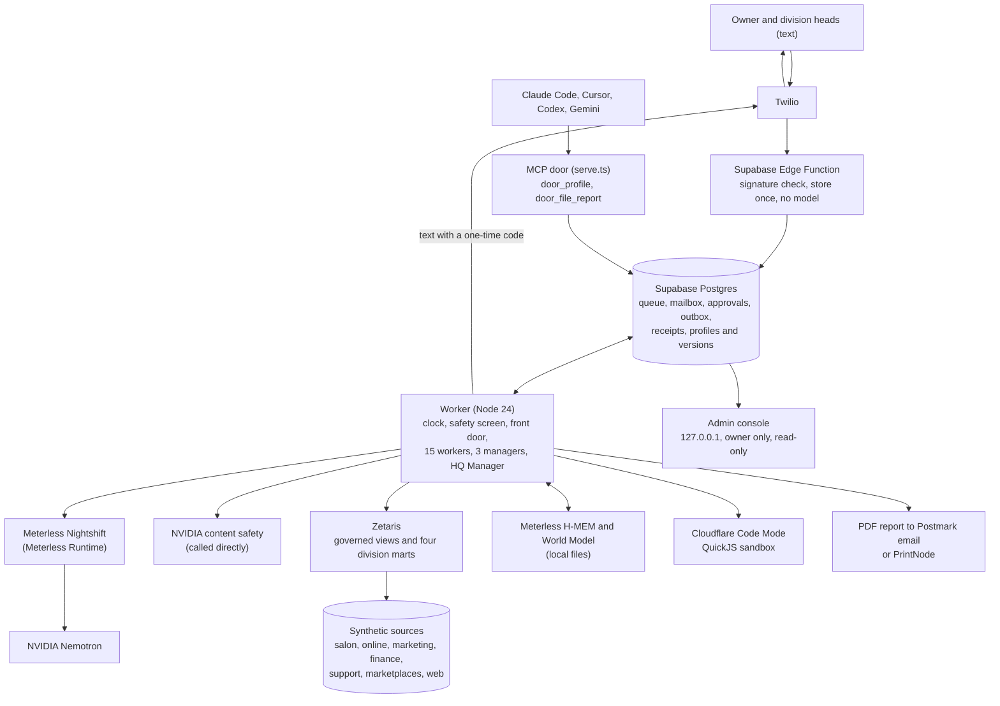

# Fortune AI Headquarters

**One company brain for a family business that is really two businesses.** AI managers watch each division's numbers,
ask each other for what they cannot see, and report to the CEO in a few lines. People approve every action with a one-time code.

Built for the Open Agent Hackathon 2026. Primary track 01, also 03 and 02 (see [Tracks](#tracks)).

> All data here is synthetic. Every record id starts with `demo-`. No customer, staff or family records, no health data,
> and no production credentials.

Jump to: [Workflow](#the-workflow-as-a-judge-will-see-it) · [Live and mock](#live-and-mock-honestly) · [Architecture](#architecture) ·
[Sponsor tech](#sponsor-technology-map) · [Quickstart](#quickstart) · [Usage](#usage) · [Tests](#tests) · [Safety](#safety-rules-each-has-a-test) ·
[Dependencies](#dependencies) · [Tracks](#tracks)

## What it is

Fortune Wigs is a family company that is really two businesses: a salon (Brooklyn and Lakewood, run by the owner's parents)
and an online wig store (run by the owner). Their numbers live in a dozen systems. The owner asked for his whole company's
analytical data in one place: *"exactly what I need to know to run my company and make profitable business decisions."*

Fortune AI Headquarters runs the company like an enterprise, in four divisions. Each has an AI manager and a human head.
**Zetaris** federates the separately owned sources into one governed view per division. **Nemotron**, served through
**Meterless Nightshift**, writes the words. A program, not a model, sets every status and checks every number. Heads approve
actions with one-time codes sent by text. The CEO gets a digest of a few lines. Salon money and online money are never added
together. Staff's own AI tools can connect to an assistant's profile through the same read-only stdio door and report back
(the demo uses Claude Code; any MCP client can run the same command), and an **HQ Manager** learns from all of it.
A **Legal Team** gives a first legal-risk read, and never a figure or citation that is not in front of it.

## The workflow, as a judge will see it

### The company, in four divisions

| Division | AI manager | Human head | What it may read |
|---|---|---|---|
| Salon | Cindy | Esther | salon numbers only (a stand-in for Cindy's own separate app, on synthetic data) |
| Finance | George | Alan | both businesses' money, kept side by side, never added |
| Online | Georgette | Emma | online numbers only |
| HQ / CEO | Joey (the CEO's assistant, id `owner`) | Ezra | one status line per division |

Two more assistants sit beside them: the **HQ Manager** (reviews everyone's work, keeps each assistant's profile in
Supabase) and the **Legal Team** (a legal-risk assistant staff reach through a door). Neither has a phone number or a person.
Joey, George, Georgette and Cindy text; in the deployed demo Cindy sends from her own line, and every head's texts reach
the owner's phone, which stands in for Alan, Emma and Esther.

### A day in the system (New York time)

| When | What happens |
|---|---|
| 07:00 | **15 daily workers** run: 7 for Finance, 5 for Online, 3 for Salon; 13 have their data connected (see [Known limits](#known-limits)). Each reads only its own division's mart through Zetaris and writes a short report. A program sets the status (normal, watch, act). The model writes the words; every number must trace to a metric, or the report falls back to a rule-written one that says so. |
| Monday 07:30 (or `REPORT` by text) | Each manager writes its **weekly report** from its workers' reports. **George** adds a *goal of the week* (one metric, its current value, a target, a date within 7 days) and *three profit paths*, each with arithmetic, a test and a stop-loss. Georgette and Cindy give up to three ranked actions. |
| 08:00 | Each division writes its **daily brief**. |
| 08:30 | **Joey's CEO digest**: one text, a heading and one line per division, at most 480 characters, written by a program and never by a model. A normal division reads "running normally." |
| 09:00 | The **HQ Manager** reviews everyone's work (and, separately, what outside AI tools reported through their doors). |

Between those, the system does four things you can watch:

1. **Managers ask each other.** A manager that cannot answer from its own mart sends a plain question to another division's
   assistant. The other answers from its own data with its own tools. Only numbers tied to a metric id of the answering
   business are kept; a number with no id, or a number no tool returned, makes the program refuse the whole answer. The
   standing asks are walls with a reason:

   | Who asks | Whom | For | Why it is an ask |
   |---|---|---|---|
   | George | Cindy | client segments (counts, revenue) | client metrics are read by Salon and HQ only, never Finance. Not built yet: the answer says "data not connected yet" |
   | George | Georgette | product performance, cost against profit, returns and reasons | product, returns and review metrics are Online and HQ |
   | Georgette | George | Amazon and Walmart stock, to restock | marketplace stock is Finance and HQ, never Online |
   | Georgette | Cindy | how long repairs take (personalization is not built yet) | Online never reads salon metrics |

2. **A head approves by code.** Each head gets a text with the report's actions and a six-digit, single-use code. The head
   replies `APPROVE 1 3 <code>`. The decision is recorded in the division's H-MEM, in the World Model and in the HQ Manager's
   mailbox. **The program carries nothing out.** The head does.

3. **Reports go out as documents.** The weekly packet is a PDF (the manager's report, then one page per worker). It goes
   to the head's printer if one is set, and by Postmark email to the one address the owner configured.

4. **The HQ Manager learns.** Every finished task leaves a work report. A review reads them through Code Mode and
   recommends at most three typed changes to an assistant's profile: a lesson, a skill note, a retirement of one, a change
   of what it may read, a change of model. The owner approved in writing that the manager applies lessons, notes and
   retirements **by itself** (it retires only what it put there itself), but only in a review that read no outside report.
   The 09:00 internal daily review never reads them. Two safety rules hold the rest for the owner's code:
   - a review that carried any outside door report applies nothing by itself (an owner's `REVIEW` reads both kinds);
   - a recommendation about a different assistant than the one whose door filed the report applies nothing by itself.

   Those, and every read-tool or model change, wait for the owner's `ADOPT` code. Every change is a new, append-only profile version,
   and `scripts/revert-profile.ts` puts an earlier version back (it refuses one that no longer passes the rules).

### Doors and the Legal Team

An outside AI tool runs `packages/codemode/src/serve.ts` as a stdio MCP server with a **door token**. Claude Code is shown in
the demo; Cursor, Codex or Gemini CLI can connect through the same command. The token belongs to one assistant. With only the public anon key, a tool can call exactly two database functions:
`door_profile` (read that assistant's profile) and `door_file_report` (file an end-of-work report; phone numbers and codes
are masked before storage). It is a read-only door with one write.

The **Legal Team** is a profile like the others, loaded through a door by a staff member. It reads contracts and the
company's own policies and returns Green, Yellow or Red for each clause, what to ask for instead, and whether an attorney
must look. It says it is not a lawyer. It never signs, accepts, files or sends. It reads no business data. Its door reports
reach the HQ Manager, and it has its own console tab. When the owner asks it something through Joey, it has its own
answer rules, held by the program, not only the prompt: no figure, deadline, citation or case that is not in the facts
(one correction round, then the facts are sent instead), and every text ends "I have not seen the document; this is not
legal advice."

### The original flagship, still in the build

The owner texts Joey: *"Get me three plans to double profit this month."* The webhook stores the task once and answers in about
a second with no model. A safety screen and the front door run together. Finance, Online and Salon propose at once from their
own slice. A validator rejects any plan whose numbers do not trace. Joey picks three and says why. The owner replies
`SEND 2 <code>`, the finance owner replies `CONFIRM <code>`. Then: *"Why plan 2?"* is answered from the World Model graph:
who asked, who proposed it, why it was picked, every metric it cited with its Zetaris view and query hash, and who decided.

## Live and mock, honestly

| Piece | State | Evidence |
|---|---|---|
| Business numbers | **Real Zetaris** (local Docker) over **synthetic** REST sources: 21 sources in 7 Lightning databases | On the first 12 sources (5 databases), 145 of 145 comparisons equal an independent computation (`npm run zetaris:setup -- --v2 --verify-only`). On all 21, every division's read equals it for `2026-10-mtd` and `2026-09` (8 reads, 590 values, 0 mismatches; `docs/lanes/w2-data.md`). The full 21-source `--verify-only`: [run: v2 proof count] |
| Model calls | **Real**: Nemotron through Meterless Nightshift on the owner's PC, with the NVIDIA key inside Nightshift. This is the deployed configuration: the live worker runs `MODEL_PROVIDER=meterless` and `GUARD_PROVIDER=nvidia` | Lightning answered in about 2 s and Ultra in about 5 s (short probes, not plan writes); a wrong token gets 401 |
| Safety screen | **Real**: asks NVIDIA directly | Nightshift does not serve the content-safety model, so `GUARD_PROVIDER=nvidia`. Every other call goes through Nightshift |
| Report email | **Real**: Postmark | George's weekly packet for Alan went out with the PDF attached, to the owner's address only, and arrived |
| Texts | **Real**: Twilio, to the owner's registered demo phone, which stands in for every head (Alan, Emma, Esther) | The inbound webhook is a Supabase Edge Function on the cloud project. Signed probe: forged request 403, retry not answered twice |
| Database | **Real**: Supabase. Local stack for development and tests, cloud project for the webhook, the console and the live worker | Cloud, read back on 2026-10-27: 18 migrations, the newest `20261027130100`; the public (anon) role holds no table privilege and can run only `door_profile` and `door_file_report`; the six profiles (owner, finance, salon, online, manager, legal) are seeded in the database, and the worker loads them from there |
| Memory and record | **Real** Meterless engines (Apache-2.0, pinned commit), local files | `packages/brain/test/` |
| Code Mode | **Real**: QuickJS sandbox | `packages/codemode/test/codemode.test.ts` |
| Data | **Synthetic.** Each source has exactly one planted bad row that must be rejected in its own month only | `packages/data/test/operations.test.ts`, `year.test.ts` |
| Salon assistant | **Stand-in** for the head stylist's own app | No salon client segment, product sales or personalization feeds yet (see [Known limits](#known-limits)) |
| Full-chain tests | **Mocked** models and data, real local database and real Meterless engines | `apps/worker/test/chain.test.ts` |
| Live end-to-end run of the merged build | The live worker runs it; today's 15 workers were queued on 2026-10-27 | [run: live end-to-end run: tasks run, outcome] |
| Printing | PrintNode only when a printer is configured; otherwise skipped with a reason | No printed report recorded |
| Money, customers, ads | **Nothing moves money, messages a customer, publishes or changes an ad** | `AGENTS.md`; no assistant has a write tool. The one write at a door is an end-of-work note to the HQ Manager |

## Architecture



Where state lives:

| State | Where |
|---|---|
| Tasks, mailbox, approvals, outbox, receipts, profiles and their versions | Supabase Postgres. Row level security on every table; the worker uses a server-side key |
| Who asked what, what was proposed and decided, which metrics were cited | Meterless World Model, namespace `fortune-demo`, append-only |
| Each assistant's lessons and decisions | Meterless H-MEM, one store per assistant. The database holds the lessons; H-MEM is a cache |
| Business numbers | The sources themselves, read through Zetaris. Every metric carries its mart table and a SHA-256 hash of the view bodies and the query |
| Secrets | `.env.local` (mode 600) and Supabase secrets. Never in git, logs, receipts or prompts |

More: [`docs/architecture.md`](docs/architecture.md) · [`docs/divisions.md`](docs/divisions.md) · [`docs/workers.md`](docs/workers.md) ·
[`docs/manager.md`](docs/manager.md) · [`docs/data.md`](docs/data.md) · [`docs/delivery.md`](docs/delivery.md) · [`docs/legal.md`](docs/legal.md).

## Sponsor technology map

| Sponsor | What it does in this build | Code | Proof |
|---|---|---|---|
| **Zetaris** | The only way the build reads business numbers. Read-only governed views over separately owned REST sources, plus four Virtual Data Marts with no copy of the data. Three layers: period totals, derived (budget room, MER, season index, contribution) and standing as of the data date. With all 21 sources they hold 121, 14 and 23 metrics (81, 14 and 15 on the first 12). Seasonality runs inside Zetaris (`AVG(...) OVER ()`, `LAG`) | [`packages/data/src/`](packages/data/src), [`scripts/zetaris-setup.ts`](scripts/zetaris-setup.ts) | On the first 12 sources, 145 of 145 comparisons equal `computeAll`, an independent TypeScript computation from the same rows; on all 21, every division's read equals it (590 values, two periods). Version 1 is frozen byte for byte: [`frozen-v1.test.ts`](packages/data/test/frozen-v1.test.ts) |
| **Meterless Nightshift** | The primary model provider, and the deployed configuration. `MODEL_PROVIDER=meterless` points the one OpenAI-compatible client at the Meterless Runtime, which calls NVIDIA with the key set up inside Nightshift. Only the safety screen goes to NVIDIA directly (`GUARD_PROVIDER=nvidia`). The runtime's token is read from a file (or the environment) and never printed. Unset, the code still defaults to `nvidia`; `.env.example` sets `meterless` | [`packages/models/src/index.ts`](packages/models/src/index.ts), [`packages/models/README.md`](packages/models/README.md), [`scripts/check-nightshift.ts`](scripts/check-nightshift.ts), [`scripts/nightshift-bridge.mjs`](scripts/nightshift-bridge.mjs) | `packages/models/test/models.test.ts`, "Nightshift (the Meterless Runtime) as the provider" |
| **Meterless H-MEM** (engine) | One memory per assistant. A proposal is short-term and tagged unapproved; only a person's decision becomes long-term and supersedes it. Planning recalls decisions only, so an unapproved model idea is never treated as fact. A repeated, declined idea is flagged. An adopted lesson is long-term memory | [`packages/brain/src/memory.ts`](packages/brain/src/memory.ts) | [`packages/brain/test/brain.test.ts`](packages/brain/test/brain.test.ts): "never recalls an unapproved proposal as a decision, and recalls a decision once made"; "flags a new plan that repeats a declined idea, and keeps assistants apart" |
| **Meterless World Model** (engine) | The shared record: who asked what, which assistant proposed what, which metrics it cited, who forwarded, approved or declined, and the data requests, reports, reviews and adoptions. `explainProposal` answers "why" from the graph only and invents nothing for a thin record | [`packages/brain/src/record.ts`](packages/brain/src/record.ts) | `brain.test.ts`: "records request → proposal → decision, persists, and replays without duplicates"; [`links.test.ts`](packages/brain/test/links.test.ts): "gives the request and who asked it, every cited metric, and each decision with its plan rank"; end to end in [`chain.test.ts`](apps/worker/test/chain.test.ts) |
| **NVIDIA Nemotron** | Every model job (table below), and the content-safety screen on every free text | [`packages/models/`](packages/models), [`packages/profiles/src/index.ts`](packages/profiles/src/index.ts) | Live runs: [`docs/research/live-runs-2026-10-26.md`](docs/research/live-runs-2026-10-26.md) |
| **Cloudflare Code Mode** | A question to any assistant becomes one model-written script against that assistant's typed read API, run in a QuickJS WebAssembly sandbox. Only the small result goes back. Same machinery serves the worker and the MCP door | [`packages/codemode/`](packages/codemode) | `codemode.test.ts`: no network, process, module loader or timers; 30 s deadline, 50 tool calls, 32 MB. Savings: [`docs/research/codemode-savings-summary-2026-10-27.md`](docs/research/codemode-savings-summary-2026-10-27.md) |

Meterless engines implemented: **H-MEM** and **World Model**. Not implemented: Markovian and Scout Intent. The engines are
fetched, not copied: [`scripts/setup-meterless.sh`](scripts/setup-meterless.sh) clones them at commit
`1742dec56a66e58eef9dda2d2b865823758ca8cd` into `.local/meterless`.

### Where NVIDIA Nemotron contributes

| Job | Model (default) | Setting | Used for |
|---|---|---|---|
| route (front door) | `nvidia/nemotron-3.5-lightning-30b-a3b` | thinking off, 600 tokens | reads intent and the target assistant. 0.5 to 0.8 s with thinking off; 14 s and 1,436 tokens with it on |
| plan | `nvidia/nemotron-3-ultra-550b-a55b` | thinking on, 16,000 tokens | three plans per department; Joey's pick of three; the daily brief, the daily worker report and the weekly report. With thinking off, Ultra's plans were rejected twice on every prompt; with it on they passed on attempt 1 in 81.6 s |
| code | Lightning | reasoning on in the worker | the one script a Code Mode lookup runs |
| answer | Lightning | thinking off, 400 tokens | words the answer from the lookup; numbers traced |
| review | Lightning | thinking on, 6,000 tokens | the HQ Manager's review |
| guard | `nvidia/nemotron-3.5-content-safety` | 100 tokens, 1,600-character windows | the safety screen on every free text; fails closed |

Timings are from direct NVIDIA calls on 2026-10-26 ([live runs](docs/research/live-runs-2026-10-26.md)). Model names are
settings (`NEMOTRON_PLAN_MODEL`, `NEMOTRON_ROUTER_MODEL`, `GUARD_MODEL`, `CODE_MODEL`, `ANSWER_MODEL`, `REVIEW_MODEL`).

**Code Mode trade-off, measured.** In 8 live runs on Lightning (run 1 not counted: not like for like), Code Mode used 73 to 88%
fewer tokens than classic tool calling in every counted run. It was also less reliable with this small model: clean answers
were 5 of 15 with reasoning off and 4 of 6 with it on, against 20 of 21 for the tool loop. So the worker never texts a number
outside the lookup result (one correction round, then "Here's what I found: ..."). Three questions per arm per run: samples,
not averages.

## Quickstart

You need Linux or WSL2 (Ubuntu), **Node 24**, **Docker**, and Git. Local Zetaris and Meterless Nightshift are the two sponsor
installs. Everything below is on Linux or WSL unless it says Windows.

```bash
git clone https://github.com/ezra380/fortune-ai-headquarters-hackathon.git
cd fortune-ai-headquarters-hackathon
npm install
bash scripts/setup-meterless.sh                       # the pinned Meterless engines -> .local/meterless
cp .env.example .env.local && chmod 600 .env.local    # fill in names from the table below; never commit it
npm run db:start                                      # local Supabase in Docker: migrations + synthetic seed
npx tsx scripts/seed-profiles.ts                      # store the assistants' profiles in the database
```

**Zetaris.** Install and start Zetaris locally with its own getting-started guide, then put the `ZETARIS_*` names in `.env.local`
and set `FAHQ_DATA_VERSION=2` (the default, `1`, is the original single finance view).

```bash
npm run zetaris:setup -- --v2                  # create what is missing, then verify
npm run zetaris:setup -- --v2 --verify-only    # the proof: every layer, mart and DataPort read against the oracle
```

**Meterless Nightshift.** Install Nightshift on the Windows host and set up your NVIDIA key *inside* it. WSL cannot reach
Windows loopback, so a small relay connects them. On Windows, with Windows' own Node:

Find your WSL-facing adapter address first: in WSL, `ip route show default` shows it (on the demo PC it was 172.23.224.1).
Pass it as the bridge's first argument; the second is the port.

```bash
node nightshift-bridge.mjs <adapter address> 18088    # copy of scripts/nightshift-bridge.mjs; binds that adapter only, never 0.0.0.0
```

Then in `.env.local` (`.env.example` already has these lines): `MODEL_PROVIDER=meterless`, `GUARD_PROVIDER=nvidia` (plus
`NEMOTRON_API_KEY` for the safety screen), `METERLESS_BASE_URL=<adapter address>:18088`, and `METERLESS_TOKEN_FILE` set to
Nightshift's `proxy-token` file. Leave `GUARD_PROVIDER=nvidia` in: Nightshift does not serve the safety model, and an
inherited guard would fail every free text closed. Check it:

```bash
npx tsx scripts/check-nightshift.ts        # prints the runtime status and model ids, never the token
```

**Run.**

```bash
npm run worker                  # the claim loops and the daily clock (FAHQ_SCHEDULE=off turns the clock off)
npm run worker -- --once        # drain the queue once (a text that cannot be sent is a dry run)
npm run console                 # the owner's read-only console at http://127.0.0.1:5180
```

Live texts need a Supabase cloud project, the `inbound` Edge Function and Twilio numbers: [`docs/RUNBOOK.md`](docs/RUNBOOK.md).
Postmark and printing are optional; without their settings a report email or printout is skipped with a plain reason.

**Try it with less.** With no keys, `npm test` runs the unit, real-database and end-to-end tests (models mocked) once
`npm run db:start` is up. With an NVIDIA key and local Zetaris, `npx tsx scripts/try-live-plans.ts` routes a text and writes
plans on live Zetaris metrics (set `MODEL_PROVIDER=nvidia` if Nightshift is not installed).

### Environment names

Names only. Values go in `.env.local`, never in git. [`.env.example`](.env.example) lists the main ones; the rest have defaults.

| Group | Names |
|---|---|
| Model provider | `MODEL_PROVIDER` (`meterless` routes through Nightshift and is what `.env.example` and the deployed worker use; `nvidia`, the code's default when unset, calls NVIDIA directly), `GUARD_PROVIDER` (`nvidia` with Nightshift), `GUARD`, `GUARD_MODEL`, `METERLESS_BASE_URL`, `METERLESS_TOKEN` or `METERLESS_TOKEN_FILE`, `METERLESS_DIR` |
| NVIDIA | `NEMOTRON_API_KEY`, `NEMOTRON_MODEL`, `NEMOTRON_PLAN_MODEL`, `NEMOTRON_ROUTER_MODEL`, `MODEL_DAILY_TOKENS`, `MODEL_TIMEOUT_MS`, `ROUTER_MAX_TOKENS`, `PLAN_MAX_TOKENS`, `PLAN_THINKING`, `CODE_THINKING`, `CODE_MODEL`, `ANSWER_MODEL`, `REVIEW_MODEL`, `XAI_API_KEY`, `XAI_MODEL` |
| Zetaris and data | `ZETARIS_BASE_URL`, `ZETARIS_ORG_ID`, `ZETARIS_API_KEY`, `ZETARIS_USERNAME`, `ZETARIS_PASSWORD`, `FAHQ_DATA_VERSION` (`2` in the deployed worker), `FINANCE_PERIOD`, `FAHQ_SOURCE_HOST`, `FAHQ_SOURCE_PORT`, `FAHQ_SOURCE_PORT_V2` |
| Supabase | `SUPABASE_URL`, `SUPABASE_SERVICE_ROLE_KEY`, and for a door `SUPABASE_ANON_KEY`, `FAHQ_DOOR_TOKEN` |
| Twilio | `TWILIO_ACCOUNT_SID`, `TWILIO_API_KEY_SID`, `TWILIO_API_KEY_SECRET`, `TWILIO_AUTH_TOKEN`, `TWILIO_FROM_OWNER_ASSISTANT`, `TWILIO_FROM_FINANCE_ASSISTANT`, `TWILIO_FROM_ONLINE_ASSISTANT`, `TWILIO_WEBHOOK_URL` |
| Demo people | `DEMO_OWNER_PHONE`, `DEMO_OWNER_NAME`, `DEMO_FINANCE_PHONE`, `DEMO_FINANCE_NAME` |
| Report email (Postmark) | `POSTMARK_HQ_SERVER_TOKEN`, `POSTMARK_HQ_FROM`, `HQ_REPORT_TO` (the one address every report email goes to) |
| Printing | `PRINTNODE_API_KEY`, `PRINTNODE_PRINTER_OWNER`, `PRINTNODE_PRINTER_FINANCE`, `PRINTNODE_PRINTER_ONLINE`, `PRINTNODE_PRINTER_SALON` |
| Other | `CONSOLE_PORT`, `FAHQ_SCHEDULE`, `PROFILES_SOURCE`, `SUPABASE_DB_URL` (for the profile scripts), `WEEKLY_MAX_TOKENS` (default 12000) |

## Usage

### Text commands

Commands are parsed by fixed rules, never by a model. A near miss ("ok send 2 ... thanks", a bare "ok") never reaches a
model and gets a hint; "yes" is Twilio's own keyword and is left to Twilio. `<code>` is the six-digit code in the text you were sent.

| Text | Who | What it does | Example |
|---|---|---|---|
| any free text | owner: any assistant. A head: her own | safety screen, front door, then a Code Mode lookup | `What did the salon take in last week?` |
| plans | owner | three plans from the departments, Joey picks three | `Get me three plans to double profit this month` |
| `SEND <1-3> <code>` | owner | forwards one plan to the finance owner (code lives 15 min) | `SEND 2 <code>` |
| `CONFIRM <code>` / `DECLINE <code>` | finance owner | decides the forwarded plan | `CONFIRM <code>` |
| `APPROVE <ranks> <code>` | division head | records approval of a brief's or weekly report's actions or paths, once each (12 h for a brief, 24 h for a weekly report) | `APPROVE 1 3 <code>` |
| `ADOPT <ranks> <code>` | owner | puts the HQ Manager's recommendations that wait for him into force as a new profile version (12 h) | `ADOPT 1 2 <code>` |
| `REVIEW` | owner | asks the HQ Manager for a review now | `REVIEW` |
| `BRIEF` | owner: all three divisions. A head: her own | a brief now | `BRIEF` |
| `REPORT <division>` | owner: `FINANCE`, `ONLINE`, `SALON` or `ALL`. A head: her own | a weekly report now | `REPORT FINANCE` |
| `STATUS` | owner, or a head | the owner gets the digest as it stands; a head gets her count of open items | `STATUS` |
| `Why plan 2?` | owner | answered from the World Model graph | `Why plan 2?` |

A code is single-use, stored only as a hash, tied to one person and one action, and locks after five wrong tries. A plain
"yes" never counts, and a code under the wrong command word is refused without being spent. Twilio's own keywords (STOP,
HELP and the rest) are left to Twilio.

### The console

`npm run console` serves the owner's console at `http://127.0.0.1:5180` (loopback only, GET and HEAD only). The service key
stays on the server, phone numbers show their last four digits, and any six-digit run is blanked.

- **Company**: the CEO digest, each division's latest brief with where each action stands (waiting for a code, approved,
  expired, locked), and the questions the divisions asked each other.
- **Finance, Online, Salon**: the manager line ("George, Finance, reports to Alan"), the weekly report (goal, three paths with
  arithmetic, actions, what was asked of other divisions, where each approval stands), every worker's latest report, and PDF
  links.
- **A head's own page**: `/?division=finance`, `/?division=online` or `/?division=salon` shows only that division.
- Tabs also for **Joey (Owner HQ)**, **Finance Department**, **Online Customer Service Department**, **HQ Manager**, **Legal
  Team** and **Salon Department (stand-in for Cindy)**.

### Give an outside AI tool a door

```bash
npx tsx scripts/issue-door-token.ts finance "Claude Code"   # prints only a file path; the token is in .local/door-tokens/finance.token (mode 600)
```

Assistants: `owner`, `finance`, `online`, `salon`, `manager`, `legal`. Only the token's SHA-256 is stored. Then start the door as
an MCP server from the tool (Claude Code, Cursor, Codex or Gemini CLI use the same stdio command):

```bash
FAHQ_DOOR_TOKEN=$(cat .local/door-tokens/finance.token) SUPABASE_URL=<project url> SUPABASE_ANON_KEY=<public anon key> \
  npx tsx packages/codemode/src/serve.ts --profile finance        # Code Mode: one `code` tool, plus `file_work_report`
npx tsx packages/codemode/src/serve.ts --local                    # offline: the file profiles, no database, no report
claude mcp add fortune-brain -- npx tsx packages/codemode/src/serve.ts --local
```

A wrong, revoked or missing token stops the door with one plain sentence. Nothing falls back to the files. See
[`docs/manager.md`](docs/manager.md) and [`docs/legal.md`](docs/legal.md).

### See and undo what the HQ Manager changed

```bash
npx tsx scripts/revert-profile.ts finance --list    # every version: who made it, when, why
npx tsx scripts/revert-profile.ts finance 3         # write version 3 back as a new version made by the owner
```

## Tests

```bash
npm run typecheck
npm test
flock ~/.fahq-db-test.lock npm test      # when more than one checkout can reach the same local database
```

- The real-database tests share one local Postgres and run one file at a time. **Run any database-backed test under
  `flock ~/.fahq-db-test.lock`** when several runs may overlap, because the worker's tests cancel every queued task.
- The Meterless tests skip when `.local/meterless` is missing (`bash scripts/setup-meterless.sh`). A run that skipped them says
  so in its totals. To run just the engine tests: `npx vitest run packages/brain`.
- Totals on the merged build (`38a3094`'s tree, 2026-10-27, with the Meterless engines present): **87 files; 1,641 tests passed,
  1 expected fail, 0 skipped, 0 failed.** The expected fail is an `it.fails` wall test for the salon feeds that are not built yet;
  it turns red the day their metrics land. `npm run typecheck`: clean.
- Beyond unit tests, the build was proved with: tests seen failing before the fix; mutation checks (each guard broken in turn,
  tests seen red, then restored); real-Postgres tests; live Zetaris comparisons against an oracle; an adversarial review by
  172 agents (7 medium findings fixed); and an independent review of each lane.

## Safety rules (each has a test)

| Rule | Test |
|---|---|
| Synthetic data only. No health data in any column, value, metric or view | [`packages/data/test/no-medical.test.ts`](packages/data/test/no-medical.test.ts) |
| The webhook accepts only a valid Twilio signature (else 403) and leaves Twilio's own keywords (STOP, CANCEL, HELP) to Twilio | [`supabase/functions/inbound/test/lib.test.ts`](supabase/functions/inbound/test/lib.test.ts) |
| One task per message, even when Twilio retries. Each task runs once: lease, `SKIP LOCKED`, at most 3 attempts | [`supabase/tests/db.test.ts`](supabase/tests/db.test.ts) |
| Approvals only by code: single-use, hashed, tied to one person and one action, five wrong tries lock, a plain "yes" never counts | `supabase/tests/db.test.ts`, [`apps/worker/test/units.test.ts`](apps/worker/test/units.test.ts) (the parser) |
| No number without a source: plans, briefs, reports and answers must trace, with one correction round | [`packages/contracts/test/validate.test.ts`](packages/contracts/test/validate.test.ts), `apps/worker/test/units.test.ts`, [`packages/codemode/test/answer.test.ts`](packages/codemode/test/answer.test.ts) |
| Salon and online money are never merged: marts, catalog, plan checker, reply filter, worker numbers | [`packages/data/test/divisions.test.ts`](packages/data/test/divisions.test.ts), [`catalog.test.ts`](packages/data/test/catalog.test.ts), [`packages/profiles/test/changes.test.ts`](packages/profiles/test/changes.test.ts), [`apps/worker/test/brief-flow.test.ts`](apps/worker/test/brief-flow.test.ts), [`apps/worker/test/workers.test.ts`](apps/worker/test/workers.test.ts) |
| Memory holds only what a person decided | `packages/brain/test/brain.test.ts` |
| Model-written code runs only in the sandbox | `packages/codemode/test/codemode.test.ts` |
| Assistants are read-only: zod-checked arguments, 50 rows at most, no phone numbers, codes or message bodies | [`apps/worker/test/read-tools.test.ts`](apps/worker/test/read-tools.test.ts) |
| The safety screen runs before any model acts and fails closed | [`packages/models/test/guard.test.ts`](packages/models/test/guard.test.ts), [`apps/worker/test/screen.test.ts`](apps/worker/test/screen.test.ts) |
| Keys stay hidden: model errors never echo the provider, Zetaris errors keep the key out, the console blanks codes | [`packages/models/test/models.test.ts`](packages/models/test/models.test.ts), [`packages/data/test/zetaris.test.ts`](packages/data/test/zetaris.test.ts), [`apps/console/test/divisions.test.ts`](apps/console/test/divisions.test.ts) |
| The public (anon) role reads nothing and can run exactly two functions | `supabase/tests/db.test.ts`, [`supabase/tests/migrations.test.ts`](supabase/tests/migrations.test.ts), [`supabase/tests/profiles.test.ts`](supabase/tests/profiles.test.ts) |
| Spending caps: a daily model-token cap that fails closed | `packages/models/test/models.test.ts` |
| The HQ Manager's two safety rules, and its text rules for a lesson | [`apps/worker/test/manager-decides.test.ts`](apps/worker/test/manager-decides.test.ts), [`packages/contracts/test/typed-change.test.ts`](packages/contracts/test/typed-change.test.ts) |
| A report email goes to one plain address only, once | [`packages/delivery/test/email.test.ts`](packages/delivery/test/email.test.ts), [`apps/worker/test/outbox-reports-db.test.ts`](apps/worker/test/outbox-reports-db.test.ts) |
| The Legal Team reads no business data | `packages/profiles/test/changes.test.ts`, [`apps/worker/test/legal.test.ts`](apps/worker/test/legal.test.ts) |
| The CEO digest is written by a program and has no number of its own | [`apps/worker/test/digest.test.ts`](apps/worker/test/digest.test.ts) |

## Known limits

- **Receipts do not record the provider.** They record the model and whether the call was live.
- **The safety screen asks NVIDIA directly**, because Nightshift does not serve the content-safety model.
- **Code Mode is less reliable than the tool loop with this small model** (see above). The worker catches an invented number; it
  cannot catch a real number read for the wrong question.
- **The salon feeds are incomplete.** Salon client segments, salon product sales and personalization turnaround are not built
  ([`docs/wave2.md`](docs/wave2.md) items 7 and 8). So 13 of the 15 workers have data connected: `salon.clients` and
  `salon.turnaround` stop plainly with "data not connected yet", and so does George's ask to Cindy for client segments.
- **Reads across 21 sources can be slow.** Division reads on 21 sources passed live for `2026-10-mtd` and `2026-09` (590 values,
  0 mismatches); under load the salon and HQ reads took up to about 290 s, close to Zetaris's five-minute connection limit.
  Every division's period table still reads all 21 sources; the next fix is a period view per division.
- **The sources and the metric catalog are declared in code.** The build does not infer schemas.
- **The model-token cap is per worker process** and is not shared across restarts.
- **The provider default in code is `nvidia`.** The deployed worker and `.env.example` set `MODEL_PROVIDER=meterless`.

## Dependencies

Node 24 (`.nvmrc`), npm workspaces (`apps/*`, `packages/*`).

<details><summary>npm packages (from the package.json files)</summary>

| Package | Version | Where |
|---|---|---|
| `@cloudflare/codemode` | ^0.5.5 | `packages/codemode` |
| `quickjs-emscripten` | ^0.32.0 | `packages/codemode` |
| `@modelcontextprotocol/sdk` | ^1.32.2 | `packages/codemode` |
| `@cfworker/json-schema` | ^4.1.1 | `packages/codemode` |
| `zod` | ^4.6.7 | contracts, profiles, codemode, worker |
| `@supabase/supabase-js` | ^2.118.0 | worker, console |
| `pdf-lib` | ^1.17.1 | `packages/delivery` |
| `pg` | ^8.23.1 | dev; profile scripts and database tests |
| `supabase` (CLI) | ^2.122.0 | dev |
| `tsx` | ^4.23.15 | dev |
| `typescript` | ^7.0.2 | dev |
| `vitest` | ^5.0.5 | dev |
| `@types/node`, `@types/pg` | ^26.6.5, ^8.23.1 | dev |

</details>

Services and tools: Docker (local Supabase and Zetaris), Zetaris (local), Meterless Nightshift, an NVIDIA API key (inside Nightshift,
and for the safety screen), the Meterless open engines (fetched by `scripts/setup-meterless.sh`). Optional: Twilio, Postmark,
PrintNode, a Supabase cloud project.

## Pre-existing components (declared)

- **Meterless open engines** (Apache-2.0), fetched at a pinned commit, not copied.
- **The idea** of the owner's existing internal platform. **No code, schema or data** from it is in this repository.
- **The repository's first 12 commits** (2026-10-26, 13:24 to 13:59 ET) were made under the owner's own GitHub account, not
  taken from a hackathon or vendor template: GitHub's "Initial commit", a planning README, `AGENTS.md`, `.gitignore`, a
  placeholder `.env.example`, `docs/architecture.md`, `src/integrations/contracts.ts`, and a small Meterless H-MEM plus Nemotron
  command-line runner (`scripts/sponsor-demo.mjs`, its test `scripts/sponsor-demo.test.mjs`, `docs/sponsor-setup.md` and
  `data/synthetic/service-demo.json`, invented service records). They are declared here so nothing is hidden. The divisions,
  workers, marts, managers, profiles, doors, delivery and Legal Team are all later work.
- **Cindy's own separate app** is referenced, not included. The Salon assistant here is a stand-in on synthetic data.
- **Zetaris's sample databases** are not used.
- **Anthropic's Legal plugin skills** are named by the Legal Team's skill and live in the staff member's own session, not in this repo.
- Third-party packages: see Dependencies.

## Credits

Built by Ezra Tobias with **Claude Code**: most commits carry a Claude co-author trailer. The build ran as parallel lanes on git
worktrees, each reviewed by an independent reviewer, with fix rounds.

- **Cursor:** not used to build this; the repo carries only a rules file (`.cursor/rules/fortune-hq.mdc`) for anyone who opens it in Cursor.
- **Sponsors:** Zetaris, Meterless (Nightshift, H-MEM, World Model), NVIDIA (Nemotron), Cloudflare (Code Mode).
- **Also used:** Supabase, Twilio, Postmark, PrintNode, pdf-lib, QuickJS, the Model Context Protocol.

## Tracks

**Primary track: 01 Solving Fragmented Intelligence.** Also entered under **03 Reasoning Architecture** and
**02 The Agent That Can Explain Why**, because the same build supports both (cross-track relevance, not scored twice). The Wildcard
[Tinkerer] track is not claimed: the repository started on 2026-10-26.

| Track | The challenge | What to look at | Limit |
|---|---|---|---|
| **01** (primary) | "Demonstrate a clever ability to discover and work across fragmented data sources" | Company numbers in 21 separately owned sources across 7 Lightning databases, federated by Zetaris into four governed division marts. Salon and online are never merged. Each manager asks another division for what its own mart does not hold. On the first 12 sources, 145 of 145 comparisons match an independent computation; on all 21, every division's read matches it | Sources and the metric catalog are declared in code, not discovered. Data is synthetic |
| **03** | "Demonstrate a novel ability to turn data, knowledge, memory, and reasoning into reliable decisions and actions" | Data: Zetaris marts and statuses a program sets from fixed rules. Knowledge: profiles in Supabase with versions. Memory: H-MEM keeps only what a person decided. Reasoning: Nemotron writes words and never sets a status. Reliability: number tracing, one correction round, then a rule-written fallback that says so, a fail-closed safety screen, keyed steps. Actions: a one-time code. The HQ Manager turns work reports into lessons and profile versions, applying them by itself only when no outside report is involved | "Actions" are recorded human decisions; the program never acts on a live system. Outside reports, read-tool and model changes still wait for the owner's code |
| **02** | "investigate complex questions across multiple data sources, connect findings, and produce evidence-backed answers or recommendations" | "Why plan 2?" is answered from the World Model graph: who asked, which department proposed it, why it was picked, every cited metric with its Zetaris view and query hash, who decided. Every number in a plan, brief, worker report or weekly report must trace or is refused. George's goal and three paths each carry evidence, a test and a stop-loss | The check proves a number is traceable, not that an assumption is wise. Code Mode answers were clean 4 of 6 with reasoning on. The explain path is exercised on mocked models in tests |

In one line each. **01:** fragmented sources made one governed picture without merging two businesses. **03:** the model never
sets a status, an unapproved idea is never remembered as a decision, and only a person's code turns a proposal into an action.
**02:** every figure and every recommendation traces back to the source that produced it, and the system can say why.
